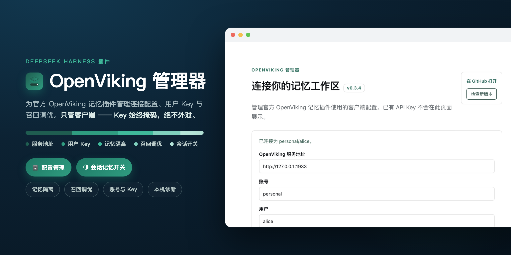
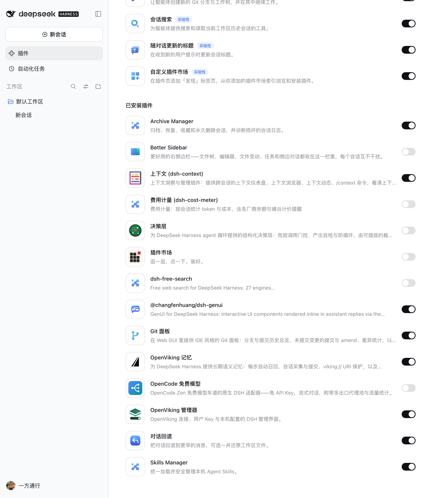
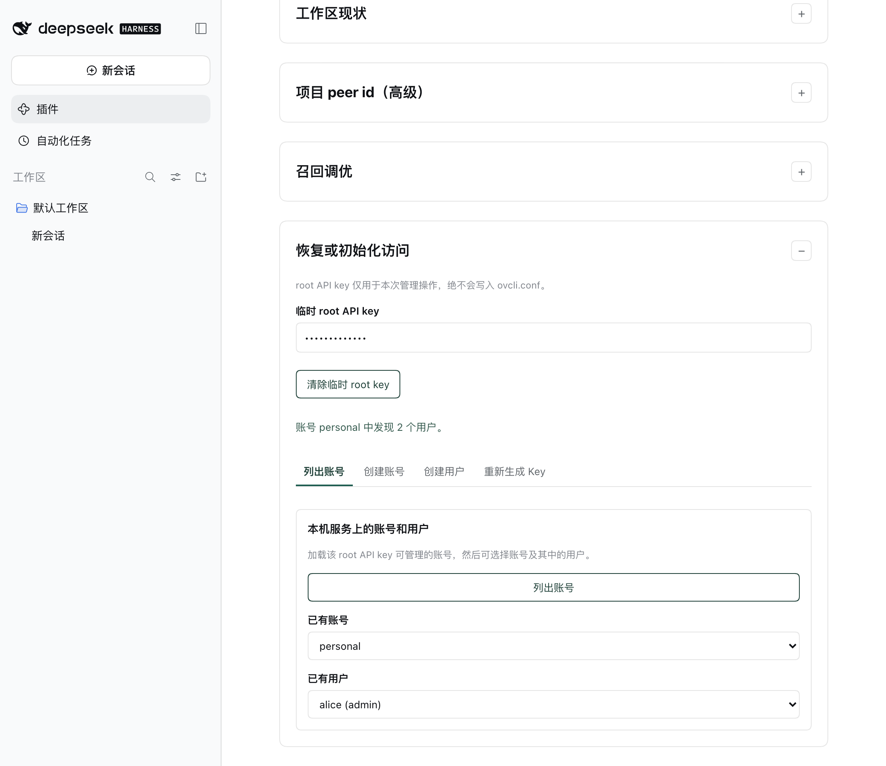
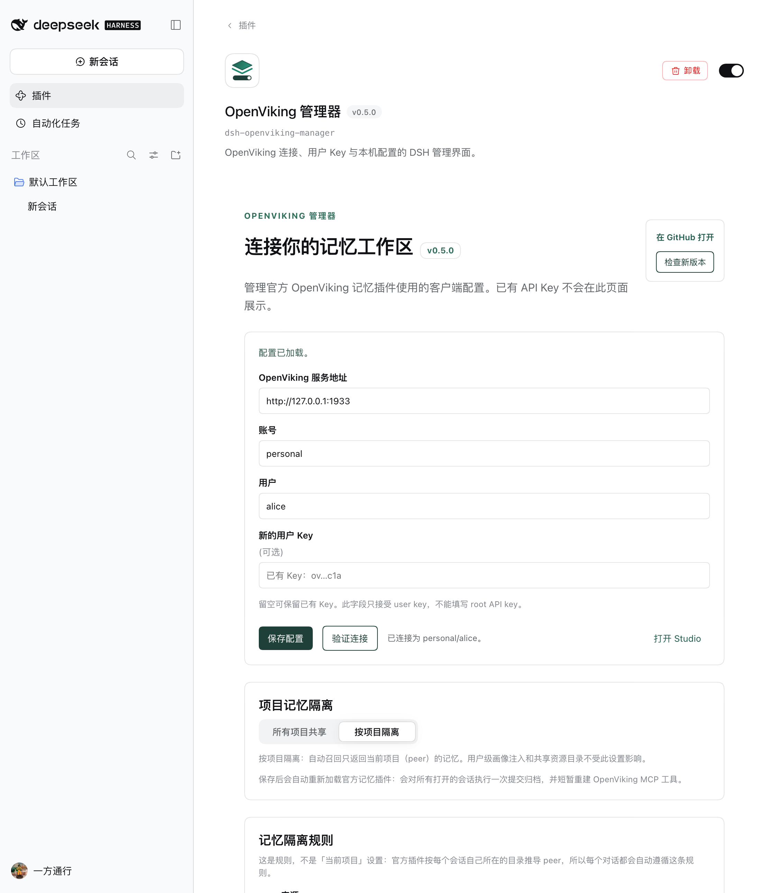
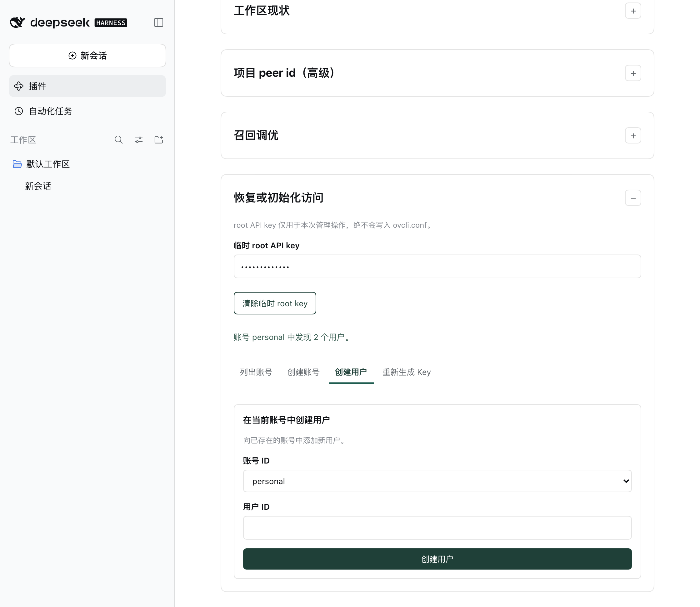

# dsh-openviking-manager

[English](README_EN.md) | 简体中文



`dsh-openviking-manager` 是一个 DSH Web UI 插件，用于管理已有 OpenViking 服务的客户端连接、用户 Key 和本机配置诊断，并提供会话级的 OpenViking 记忆开关。它只管理客户端配置与启停；记忆同步、提交和召回本身仍由官方 [`@openviking/dsh-memory-plugin`](https://www.npmjs.com/package/@openviking/dsh-memory-plugin) 负责。

OpenViking 是**火山引擎开源，专门给 AI Agent 设计的上下文数据库**，用来解决 Agent 长上下文、记忆、知识库管理问题。OpenViking 需要部署对应的服务端程序，服务支持远程访问和账号隔离，因此也适用于做跨设备、跨会话的远程记忆中心。本插件只是为 OpenViking 增加一个配置界面，便于管理本地的客户端配置。

OpenViking 的安装配置详见其官方网站：[DeepSeek Harness 记忆插件](https://docs.openviking.ai/zh/agent-integrations/17-dsh)

## 安装

```bash
# 安装 openviking 的官方插件
dsh plugin --profile web add @openviking/dsh-memory-plugin@latest
# 安装配置管理器
dsh plugin --profile web add dsh-openviking-manager@latest
```

全新安装（包名首次加入 profile）在默认 `web` profile 下即装即用：HMR 开启，装完不必重启、不必刷新页面。只有更新已安装的同名包、或使用 HMR 关闭的 profile（headless / SDK / ACP）时，才需要重启 `dsh web`。之后在 DSH 插件页面可以看到 `openviking-manager` 的配置管理页面。

也可以直接安装某个 GitHub Release 的附件——预发布版本只发这里，不发 npm：

```bash
dsh plugin --profile web add https://github.com/xbzbing/dsh-openviking-manager/releases/download/<TAG>/dsh-openviking-manager-<VERSION>.tgz
```

`lib/` 编译产物不入库，因此不支持 `dsh plugin --profile web add github:xbzbing/dsh-openviking-manager`：git 安装拿到的是一棵没有产物的源码树，插件加载不起来。

## 功能

- 读取、导入和原子更新 `~/.openviking/ovcli.conf`；
- 保留已有 `user_key`，页面仅显示掩码而不回传明文；
- 检查 OpenViking 的 `/health`、`/ready` 与用户身份；
- 检查 `ovcli.conf` 的 JSON 格式和文件权限，并提供经确认的权限修复；
- 本机发现：读取 `~/.openviking/ov.conf` 的非敏感状态，例如认证模式、是否存在 root key；`ovcli.conf` 始终优先；
- 临时使用 `root_api_key` 调用官方 Admin API：列账号、列用户、创建账号/用户、重新生成用户 Key；
- 根据当前 endpoint 推导 Studio 地址（`<endpoint>/studio`），允许用户手工改为反向代理地址；
- 会话级 OpenViking 开关：对话输入框左侧的按钮（默认开启）。关闭某个会话后，本插件会拦截官方插件在该会话的上下文注入、记忆写入/提交，并拒绝其 `mcp__openviking__*` 工具调用，使该会话不再读写 OpenViking；
- 项目记忆隔离（**默认开启**）：写入 `plugin.dsh.recallPeerScope`，首次打开配置页且没有任何层定义该值时自动写入 `actor` 并重载。`actor` 只召回本项目 peer 的记忆；peer 由官方插件按每个会话所在 workspace 的 git 身份（远端优先、无远端用仓库根）推导，于是**同一项目跨 agent、跨机器、跨 clone/worktree 共享一份记忆，不同项目即使同机同 agent 也互相隔离**。关闭开关写 `plugin.dsh.recallPeerScope: "all"`，回到官方默认的「本项目优先、跨项目降权」；写的是 DSH 作用域，不会改动本机其他 harness 的共享 `plugin` 段；
- 项目面板：可填项目目录（默认宿主启动目录）单独解析，显示仓库根、项目 peer 及其推导来源、召回范围的**生效值与来源**；并列出仓库里 `.openviking/config.json`、`config.local.json` 以及 `~/.openviking/workspaces/<slot>.json` 的声明——这些工作区层的优先级**高于** `ovcli.conf`，其中会把隔离改宽的项（`recall.peer_scope: all`、`recall.enabled: false`、`capture.enabled: false`、`peer.id` 钉死）会以错误/警告列出；目录不在 git 仓库时提示「推导不出 peer，会写入所有非项目目录共用的用户级空间」。本插件只读这些文件，**从不写入**工作区配置；
- 召回调优：在同一页调整官方插件的自动召回参数 —— `scoreThreshold`（召回分数阈值，本插件默认 0.5、官方默认 0.35）、`recallLimit`（单次注入条数上限，默认 10）、`recallQueryExpansion`（查询扩写，本插件默认关闭、官方默认 auto）、`recallExcludeUris`（排除的 URI 子树，适合屏蔽 skills、resources 目录索引这类样板内容）、`recallEventsDecayProtection`（事件记忆的衰减保护时长，如 `7d`；留空＝服务端默认不保护）、`timeoutMs`（请求超时，本插件默认 15000 毫秒、官方 dsh 默认 10000）、`recallContextTimeoutMs`（召回搜索超时，官方默认 0＝按请求超时与扩写/改写地板派生）。后端 search/rerank 卡死时调低这两个超时，可让召回快速失败、不再拖住整个回合（会话感知搜索有 15s/45s 地板，只有 `recallContextTimeoutMs` 设正值才压得动）。键名与取值域严格取自官方 config-schema，只写 `plugin.dsh` 并保留其他键与共享 `plugin` 段；分数阈值、查询扩写与请求超时带**产品默认**，首次打开配置页且没有任何层定义该键时自动写入并重载，字段留空即回到该键的默认值（并同时清掉共享段里的同名键，避免残留值继续生效）；`OPENVIKING_*` 环境变量与工作区层优先级更高，被覆盖的字段只读并显示警告；保存后自动重新加载官方记忆插件；
- 项目 peer id（高级，**默认留空**）：写入 `plugin.dsh.peerId`，用来在 git 身份描述不了目录时手工指定 peer。它与隔离开关是两件事——隔离开关决定「召回范围」，peer id 决定「你是谁」：
  - **留空（默认，也是推荐）**：官方插件按每个会话所在 workspace 的 git 身份自动推导 peer，一个仓库一份记忆，跨 agent、跨机器共享，无需逐仓配置；此时 DSH 日志里的 `OpenViking MCP: actor-scoped recall needs an explicit peer id ...` 属正常现象，只影响模型手动调用的 MCP 工具；
  - **填写**：**本机所有项目**共用这一个 peer，会破坏按项目隔离，仅用于没有 git 身份的目录。「填入当前仓库」用官方解析（含工作区层声明的 `peer.id` / `peer.source`）给出建议值。`ext-` 前缀被拒绝——服务端 0.5.2 起用它承载无损外部身份。留空即删除该键并清掉共享段的残留钉死值，恢复自动推导；`OPENVIKING_PEER_ID` 与顶层 `actor_peer_id`/`peer_id` 凭据优先级更高，命中时只读并显示警告；
- UI 跟随 DSH 系统语言设置，支持简体中文和英文。

## 界面

| 在 DSH 中 | 恢复与初始化 |
| :---: | :---: |
|  |  |
|  |  |

截图由 `npm run screenshots` 在一个隔离的 DSH 实例中生成，英文版见 [README_EN.md](README_EN.md)。

## 安全边界

- `root_api_key` 只在浏览器表单和一次同源管理请求期间使用，绝不写入 `ovcli.conf`；创建/轮换完成后插件会清空该输入。
- 现有 `user_key` 从服务端本地读取，浏览器只收到掩码；连接验证可在不回显旧 key 的情况下完成。
- 多数管理路由仅接受同源请求，响应使用 `no-store`，且不在日志中记录请求头。
- 会话开关状态仅保存在插件进程内存中，重启 DSH 后所有会话恢复默认开启。
- 关闭只对之后的 agent step 生效：历史消息里已注入的 OpenViking 上下文在被压缩前仍留在该会话中；关闭期间官方插件此前排队的待提交写入仍可能由其全局恢复逻辑补发。本插件不启动、停止或修改 OpenViking 服务端，也不替换官方记忆插件。
- 隔离开关只写官方声明的 `plugin.dsh.recallPeerScope` 键（`actor` / `all` 都显式写入，避免删键回落到共享段的值），只作用于 DSH，不改动共享 `plugin` 段里其他 harness 的设置，`ovcli.conf` 中的其余键（含凭据）一律保留。保存后的自动重载只经宿主 Cordis 公开机制重载官方插件使其重读配置，不修改官方代码；副作用是对打开的会话做一次提交归档并短暂重建 MCP 工具（卡片文案已提示）。`OPENVIKING_RECALL_PEER_SCOPE` 与工作区层优先级更高，页面会显示覆盖来源。
- 工作区配置（`.openviking/config.json`、`config.local.json`、`~/.openviking/workspaces/<slot>.json`）**只读不写**：本插件把它们当作高于 `ovcli.conf` 的声明展示，并标出会破坏隔离的项；编辑工作区配置仍是用户/仓库自己的事。生效值由官方解析器（`shared/plugin-config.mjs`）算出，不自行重写合并规则。
- 召回调优只写官方声明的 `scoreThreshold`、`recallLimit`、`recallQueryExpansion`、`recallExcludeUris`、`recallEventsDecayProtection`、`timeoutMs`、`recallContextTimeoutMs` 七个键到 `plugin.dsh`，取值域按官方 config-schema 校验，越界或格式错误的请求被拒绝且不落盘。产品默认（`scoreThreshold` 0.5、`recallQueryExpansion` off、`timeoutMs` 15000）只在首次打开配置页时写入一个官方键，不修改官方默认；文件、工作区层或环境变量的取值仍然优先。`OPENVIKING_SCORE_THRESHOLD`、`OPENVIKING_RECALL_LIMIT`、`OPENVIKING_RECALL_QUERY_EXPANSION`、`OPENVIKING_RECALL_EXCLUDE_URIS`、`OPENVIKING_RECALL_EVENTS_DECAY_PROTECTION`、`OPENVIKING_TIMEOUT_MS`、`OPENVIKING_RECALL_CONTEXT_TIMEOUT_MS` 优先级更高，被覆盖的字段只读并显示警告。
- 项目 peer id 只写 `plugin.dsh.peerId`，保留未知键与顶层凭据；校验拒绝越界长度、非官方字符集与 `ext-` 前缀（服务端 0.5.2 起该前缀承载无损外部身份，官方 sanitize 会把占用者改写成 `x-ext-`）。留空即删除该键并清理共享段的残留钉死值，恢复官方的按会话自动推导；本插件**不编辑**顶层 `actor_peer_id`/`peer_id`。
- 服务端 v0.5.2 起 `/mcp` 拒绝 root key：若 `ovcli.conf` 里保存的 key 与本机 `ov.conf` 的 `root_api_key` 相同，项目面板会给出错误提示——连接探测仍会通过（探测走数据面），但所有记忆工具都会失败。该比较只在本机进程内完成，key 从不出现在响应里。
## 环境要求

- Node.js `>= 22`
- DSH `>= 0.1.6-alpha.2 < 0.3.0-0`
- 一个可访问的 OpenViking 服务
- 官方 `@openviking/dsh-memory-plugin` `>= 0.3.2`（不设上限；本仓库已完整测试至 `0.5.29`，并对 `0.5.20` / `0.5.29` 逐项核对了本插件所依赖的 runtime 接口、工作区层与配置面）

## 服务端兼容性

本插件只写 `ovcli.conf` 的 `plugin` 段，只调用数据面 `/health`、`/ready`、`/api/v1/system/status` 与 Admin 的 `accounts`/`users`/`key` 端点，不依赖任何已移除或废弃的接口，因此对 OpenViking 服务端 v0.4.22 的破坏性变更（Session `used` 上报接口移除、`/admin/accounts/{id}/settings` 与 `/admin/agent-evolution` 标记废弃、`skills/find` 返回结构调整等）无需任何适配。

唯一值得留意的语义变化（v0.4.22 #5358）：本地向量引擎（`vectordb.backend = local`/`cuvs`）的纯 cosine 分数由 `[-1,1]` 映射为 `(cos + 1) / 2`，即 `[0,1]`。排序不变、现有索引无需重建、服务端降级即恢复原始分数，但**阈值不会自动调整**。本插件的 `scoreThreshold` 默认 0.5 与官方默认 0.35 都是原样透传给服务端 `score_threshold`/`min_score` 的，映射后同等阈值下召回会放宽：

| 阈值 | 旧分数域（[-1,1]）含义 | 新分数域（[0,1]）含义 |
| --- | --- | --- |
| 0.35（官方默认） | `cos ≥ 0.35` | `cos ≥ -0.3` |
| 0.5（本插件默认） | `cos ≥ 0.5` | `cos ≥ 0` |
| 0.75 | `cos ≥ 0.75` | `cos ≥ 0.5`（等价旧 0.5 的效果） |

- 要与旧版（≤ 0.4.21）保持相同的过滤强度，把 `scoreThreshold` 调到 0.75；
- 只用远端向量库（`http`/`volcengine`/`vikingdb`）或 IP/L2/稀疏融合分数时**不受影响**，无需调整；
- 升级后若发现弱相关内容变多，可在 0.5–0.75 之间按需微调。

### OpenViking 服务端 v0.5.2 / 官方插件 0.5.29

- **项目隔离的依据没有变**：peer 仍由会话所在 workspace 的 git 身份推导（`shared/workspace-peer.mjs` 与 `workspace-identity.mjs` 在 0.5.20→0.5.29 之间无差异），`recallPeerScope: actor` 仍通过 `peer_scope` 传给 `/search/search`。
- **`/mcp` 拒绝 root key**：把 root key 当客户端 key 用的部署，升级后数据面探测正常、记忆工具全部失败；本插件新增了这条诊断。
- **外部 peer 身份改为无损 `ext-<base64>`**：旧的有损 peer 目录不会自动读取，存在歧义的数据需运维确认归属后迁移；本插件的 peer 校验因此拒绝 `ext-` 前缀，避免手工钉死时落进服务端的外部身份命名空间。
- **新增官方键**：`recallEventsDecayProtection`（事件衰减保护，0.5.29 起，已加入调优面板）；`captureRedact`（抓取脱敏，off/standard/strict，默认 standard）属于抓取面，本插件暂不暴露，需要时直接在 `ovcli.conf` 的 `plugin.dsh` 里设置。
- **默认值变化只影响官方行为**：`captureToolResults` 在 dsh 下默认开启、`resumeArchiveInject` 与 `takeoverEnabled` 默认改为关闭，都不改变本插件写入的键。
- Watch API 迁移、Working Memory 默认关闭、LangChain 导入迁移、Pi 扩展工具改名均发生在服务端或其他宿主，不影响本插件。

### OpenViking 服务端 v0.5.0

- **配置文件定位跟随官方插件**：本插件读写的 `ovcli.conf` / `ov.conf` 现按官方插件 `shared/credentials.mjs` 的同一套链解析——`OPENVIKING_CLI_CONFIG_FILE` 选 `ovcli.conf`、`OPENVIKING_CONFIG_FILE` 选 `ov.conf`，均回退到 `~/.openviking` 下的默认文件，并沿用「仅设 `OPENVIKING_CONFIG_FILE` 且其内容是 ovcli 形状时充当 `ovcli.conf`」的向后兼容。v0.5.0（#5551）把 `OPENVIKING_CLI_CONFIG_FILE` 定为 `ov status`/`ov config` 的统一真源，因此配置页始终编辑官方插件实际加载的那个文件，不会在设了该变量时写错文件。
- **`recallExcludeUris` 传目录=排除整棵子树**：v0.5.0（#5627）起，`exclude_uris` 传目录 URI 会排除整棵子树（旧版按字符串精确匹配，传目录实际什么都不排除）。本插件只把该键原样透传，键名与取值域（URI 列表）不变，无需适配；填目录时请预期其下所有条目都会被排除。
- Working Memory 默认关闭、插件 commit 归档全部消息、context 召回不再返回系统预置目录、MCP `remember` 返回文案变化等 v0.5.0 变更均发生在服务端或官方记忆插件内部，不触及本插件写的键或调用的端点，无需适配。OpenViking Gateway 是独立组件（独立进程、`ov.conf` 的 `gateway` 段、`/api/v1/admin/gateway/*`），本插件不配置、不编排网关。

## 开发

```bash
npm ci
npm run build       # 生成 lib/ 编译产物，不会生成 .tgz
npm test            # 单元测试 + Playwright E2E
```

`lib/` 不入库：构建产物由发版 workflow 在门禁通过后 `npm pack` 生成，作为 GitHub Release 附件并发布到 npm。`npm run build` 会先清空 `lib/` 再重新编译，所以删掉源码不会留下过期产物；`lib/standalone.js` 仅供 Playwright 使用，不随包发布。发布流程与正文格式见 `.github/RELEASE_TEMPLATE.md`，不要手工打 tag 或 publish。

## 测试

```bash
npm run test:unit
npm run test:e2e
```

Playwright E2E 覆盖导入并保存 `ovcli.conf`、非法 endpoint 保护、服务端 user key 验证、临时 root key 的账号/用户选择，以及中文浏览器语言渲染。

## 项目结构

```text
src/
  ovcli-config.ts       ovcli.conf 读取、校验、原子写入和权限修复
  openviking-paths.ts   跟随官方插件解析 ovcli.conf / ov.conf 的路径
  local-discovery.ts    ov.conf 非敏感发现
  openviking-client.ts  数据面连通性与身份验证
  openviking-admin.ts   官方 Admin API 适配
  manager-api.ts        DSH 同源 HTTP 路由（含会话开关）
  session-toggle.ts     会话级 OpenViking 开关的内存状态
  ov-prestep.ts         识别并剥离官方插件注入的 pre-step 消息
  ov-tool-guard.ts      关闭会话对 mcp__openviking__* 工具的拒绝
  openviking-gate.ts    对官方 OpenVikingRuntime 的按会话短路包装
  client/               DSH Web 页面、输入框开关按钮、样式和 i18n
```

## 许可证

本项目采用 [MIT License](LICENSE)。
